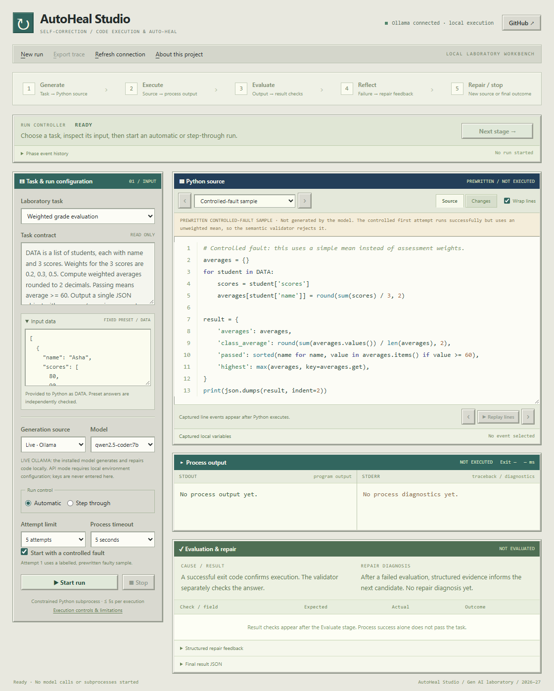

# AutoHeal Studio

A Windows 95 inspired laboratory workbench for the **Self-Correction “Code Execution & Auto-Heal” Loop**. Watch a Python candidate move through generation, execution, independent evaluation, error feedback, and repair. Every run stops at its first passing result or after at most five attempts.

**Joint Generative AI Laboratory project · LY B.Tech AI & DS · 2026–27**

| Student | Roll number | Class |
| --- | --- | --- |
| Aayush Kumar Tiwari | 16014223003 | LY AI & DS B2 |
| Prateeksha Kini | 16014223061 | LY AI & DS B3 |

[GitHub repository](https://github.com/aayushtiwari845/AutoHeal) · [Project report — PDF](docs/report/AutoHeal_Project_Report.pdf) · [Editable report — Word](docs/report/AutoHeal_Project_Report.docx)



## Launch on Windows

Double-click **Launch AutoHeal.cmd**, or run this from the repository folder in PowerShell:

```powershell
& ".\Launch AutoHeal.cmd"
```

The launcher opens [the local workbench](http://127.0.0.1:8765/) and reuses only a compatible AutoHeal Studio v2 server. Python 3.10 or newer is required; the application uses the Python standard library and dependency-free browser assets. Ollama supplies the live local model; the default is `qwen2.5-coder:7b`. Scripted replay works without a model or API key. Model loading and generation take longer than execution; the five-second limit applies to each Python subprocess.

## Inspect the complete loop

- **Automatic** advances through Generate → Execute → Evaluate → Reflect → Repair until a stop condition is met.
- **Step through** pauses before each server stage. **Next stage** releases one stage so its source, output, and evaluation can be inspected before continuing. The controller remains visible while scrolling during a manual run.
- **Captured line replay** highlights real recorded CPython line events and their bounded local variables. A line event occurs **before** that line executes. This is a replay of observations, separate from manual stage control; it is not a live debugger. A captured exception can be caught by the program and does not alone establish failure.
- The workbench exposes source with line numbers and optional wrapping, stdout/stderr, exit code, duration, expected-versus-actual result checks, concise repair diagnosis, before/after source changes, attempt navigation, and an exportable JSON trace.

The optional **controlled first fault** is an explicitly labelled prewritten candidate. It is visible before a run and is never presented as model-generated source. In live mode, the model generates subsequent repairs. In **scripted replay**, both faulty and repaired candidates are predetermined; the Python executions, errors, line events, and validations are real, while no AI model is called.

## Tasks and validation

| Verified preset | Controlled first failure | Independent checks |
| --- | --- | --- |
| Weighted grades | Exit code 0, but an unweighted mean gives the wrong answer | Weighted student averages, class average, passing names, and highest student |
| Sales summary | Summing dirty strings raises `TypeError` | Numeric cleaning, rejected rows, regional totals, and stable tie breaking |
| Text analytics | Calling `lowercase()` raises `AttributeError` | Normalized token counts, frequencies, and stable rankings |

Preset input data is fixed, and expected results are kept separate from candidate source. The model receives task rules and data, not the reference-answer object. **Exit code 0 alone never passes a preset.**

Custom tasks accept instructions and optional finite JSON input, supplied to Python as `DATA`. They check successful execution and a non-empty JSON object only. Their results are labelled **structural checks** because no independent domain-correctness oracle is provided. Controlled first faults and scripted replay apply only to the verified presets.

## Local model and optional API

**Live Ollama** uses the local service at `127.0.0.1:11434`. Task data and repair feedback remain on the laptop for this mode. **Live API** is optional and remains disabled until its provider is configured locally. API mode sends the task, input data, candidate source, and relevant failure feedback to the selected external provider.

Copy [`.env.example`](.env.example) to `.env` and fill in `AUTOHEAL_API_BASE`, `AUTOHEAL_API_MODEL`, and `AUTOHEAL_API_KEY` locally; `GROQ_API_KEY` is also accepted. The example targets the Groq compatible endpoint. Another supported provider can use an HTTPS OpenAI-compatible endpoint. Restart the server after changing `.env`; the launcher may otherwise reuse the running process. Existing environment variables take precedence.

Keys are never entered in the dashboard, returned by its status API, included in run requests, or passed to generated Python. `.env` is excluded from Git. Exported traces contain task data, source, and outputs, so review their contents before sharing. Runs remain in bounded server memory until the process exits or older completed history is removed; JSON export preserves a selected trace.

## Execution boundaries

Generated source runs in a constrained child process with AST/import/builtin restrictions, a child audit hook, a disposable working directory, no stdin, a restricted environment, bounded output and tracing, and a maximum five-second execution timeout. File, network, and process access are disallowed by these application controls. Windows adds best-effort Job Object resource limits; each attempt reports whether those limits were active.

This is **defense-in-depth execution control, not a hardened operating-system sandbox**. It is designed for trusted local laboratory work. Provider errors, invalid output, timeouts, policy violations, failed result checks, cancellation, and exhausted attempts remain explicit outcomes; none is converted into a fabricated success.

## Development checks

Run from the repository root:

```powershell
python tools/run_checks.py
node --check autoheal/web/app.js
```

The backend suite covers independent preset references, executor restrictions, output contracts, cancellation, provider handling, manual gate tokens, recorded traces, custom data, and local HTTP protections. It uses mocked providers and needs no paid API or model access. Node is optional for the JavaScript syntax check and is not an application dependency.

See the [package reference](autoheal/README.md) for component responsibilities and API routes. Current evidence is recorded in the report and repository verification logs.
